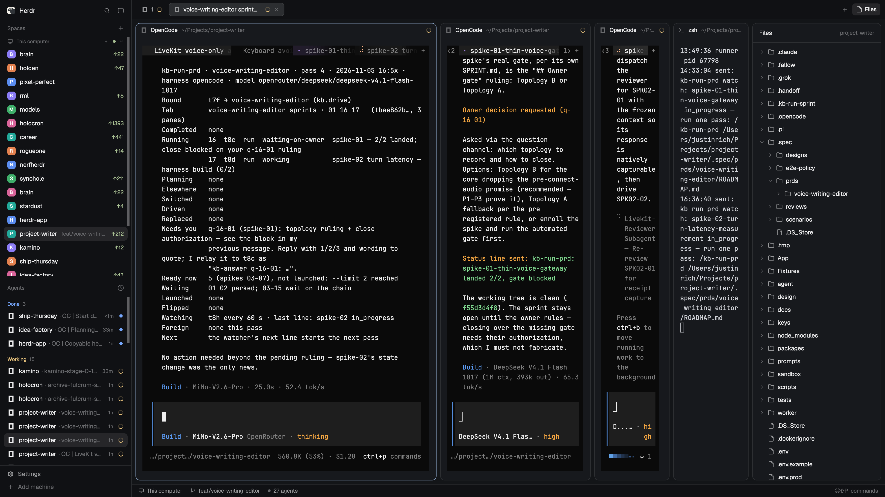

# Copyable Herdr IDs

Right-click a space, tab, pane, agent, or file in Herdr and copy a self-contained block of IDs that another session can use to find and read it.

This file is the brief: `mods/` and `layouts/` beside it are one build of it. Rebuild from this file if the shipped copies don't fit your Herdr.

## What you see

- **Copy IDs** is the first item on the space, tab, and pane right-click menus.
- **Rename pane** is the second item on a pane's right-click menu — the menu opens on the terminal area and on the pane's header. Double-clicking a pane's name, or the pen button in its header, does the same.
- Every pane header reads `Name Fix [hid]`: the pane's name, then the tag of the project it is in.
- Right-clicking an agent row in the Agents sidebar opens a popup with **Copy IDs**, **Copy terminal address**, and **Copy agent session** (when the agent reports one).
- The Agents sidebar has two orders, chosen from the button beside its tab: **Grouped by device and space** — a quiet heading per machine, then a heading per space — and **Priority** — Needs you, Done, Working, Idle.
- A live non-shell terminal on another machine shows in the Agents sidebar even when its program never reports a status. Clicking it opens its pane.
- Right-clicking a file or folder in the Files panel opens a popup with **Copy path** and **Copy path (relative)**.
- Each action shows a toast: **IDs copied** for the block, **Copied** for a single value.

## How it behaves

- **Copy IDs** on a space copies the space id and name, its tab ids, and for every terminal in it: the address, its folder, any agent session ids, and the line `hc read <address> --lines 200`.
- On a tab or pane it does the same for that tab or pane instead of the whole space.
- On an agent it starts with `agent <app> · pane … · tab … · space …`, then the terminal block for that agent.
- Remote terminals keep the machine-qualified form, e.g. `box/t7`, so the `hc read` line works from any machine that has the machine added.
- Right-clicking an agent row opens the menu; it does not focus or open the agent.
- Nothing is run and nothing is fetched; the only side effect is the clipboard write.

## Agents on other machines

- The app only fills the Agents list from terminals that report a status word. A live terminal on another machine that never reports one still gets a row here, named the same way as any agent row, and clicking it opens that pane. It has no status, no age, and no pin control.
- The API has no "this is an agent" flag, so the rows are whatever runs on another machine that is not a shell. A remote editor or build is admitted too — a known limit, taken because a row that opens its pane beats a terminal nobody can see.
- Left out: shells, every quiet program on this computer, and a remote program that is not in a pane. These are terminals, never OS processes.
- A sub-agent the program started shows under its row, as sub-agents do under an agent; it gets no row of its own unless it reports a status and is pinned.
- **Grouped by device and space** orders rows the way the app does: machines, then each machine's spaces, tabs, and panes. Every machine with a row gets a device heading (`This computer`, or the machine's name) above its space headings; folding it folds its spaces. Device headings carry no count and no status.
- **Priority** keeps its sections and puts these rows in Idle.
- Looking at one of these rows never makes it the row that holds Done open — nothing without a status is ever held. Leaving a finished agent for any other pane, these rows included, ends its hold exactly as it does today.

## Files panel icons

- Every row carries a glyph: a folder, or the kind of file. The set is [Lucide](https://lucide.dev) (ISC, `mods/ids-files/icons/LICENSE-Lucide.txt`), the same family the app's own panels draw, drawn in a 24-unit box with a 2-unit stroke.
- Each glyph is a **full-size silhouette**, not a mark inside a file outline: at 14px an inner mark shrinks to a blur. `file` stays plain for anything unknown; `book-text` is markdown, `code` code, `terminal` a shell script, `code-xml` markup, `braces` JSON, `sliders-horizontal` config and dotfiles, `hash` stylesheets, `table` spreadsheets, `database` databases, `image` pictures, `audio-lines` audio, `archive` archives, `lock` lockfiles, `file-text` prose.
- Families also carry a colour from the theme (`ansi1`–`ansi6`), so code, data, styles, prose and media read apart before the outline does. Anything without a family (`file`, `file-text`, `archive`, `lock`) stays in the muted ink, and both themes follow because the names are theme tokens.
- Two states. A folder shows `folder` closed and `folder-open` when its children are showing, in the foreground ink rather than the muted one. The file the panel is showing gets the same glyph in a **3 stroke** copy, the row's `selection` background, and its name in semibold — and, because the tree gives way to the preview, the header repeats that glyph and name so the file you are reading is still named and still bold.
- A stroke width is part of an SVG, so the heavier copy is a second file: `install.sh` writes `ids-icons/<name>-bold.svg` from each glyph when it copies the set in. Change a glyph, re-run `install.sh`.

## Pane names

- A pane can be named. The name replaces the program's own title in that pane's header, and **Copy IDs** on the pane prints it: `pane p2948… (tests) · tab tb471…`.
- Rename from the pane's right-click menu (**Rename pane** — on the terminal or on the pane's header), the pen button that appears in the header on hover, or a double-click on the name itself.
- An empty name gives the pane its program's title back.
- What the header shows, in order: the name given here; else the name whoever started the terminal gave it (`hc run --name`, which a runner such as a sprint orchestrator sets); else what the agent reports it is doing (its terminal title, once the spinner frame is trimmed); else the program (`Claude Code`, `zsh`). An assigned name always beats a derived one.
- Every header ends with the project's tag in dim text: `Name Fix [hid]`. The tag comes from the live folder — the segment right after `Projects/` (`~/Projects/herdr-ids/mods/ids-pane` → `herdr-ids`), else the folder's own name — and is three lowercase letters: a one-word name keeps its first three (`brain` → `bra`), a two-word name is the first word's initial plus the second word's first two (`herdr-ids` → `hid`), and a longer name is the initials of its first three words (`my-cool-app` → `mca`). Camel case splits like a separator, so `herdrIds` tags the same as `herdr-ids`. A home folder, a temporary folder, or no folder shows no tag.
- Names live in `shared("ids.paneNames")`, a `{ paneId: name }` map the app persists in `shared.json`, so they outlive the window and every open window agrees. Panes are keyed by their own id, so a name never follows a different pane.
- The header is the shipped `pane` (and `terminals-pane`) header with three additions: the name and its tag in place of the program name when one is set, a pen button on hover, and a right-click that opens the pane menu. Everything else — icon, folder, status, split/zoom/close buttons — is unchanged.
- The rename dialog is its own mod (`ids-rename`): a text field, Save, Cancel, Esc. It writes the map with `setShared`, which re-renders every copy, so the header changes as it saves.
- A keybinding can call `ids-pane:rename` (or `ids-terminals-pane:rename`); the header showing the focused pane opens the dialog.

## Built from

- `layouts/main-ids.json` — a copy of the shipped `main` layout with `terminal_menu: "ids-menu"` and the spaces, agents, tabs and files blocks pointed at the `ids-*` mods.
- `layouts/terminals-ids.json` — the same treatment for the `terminals` layout.
- `mods/ids-menu/` — the context menu. `items()` returns the copy actions; `choose()` calls `cx.write_to_clipboard(...)` and `notify(...)`.
- `mods/ids-agents/` — the Agents sidebar, with a right-click that opens `ids-menu` with `tab: "agent"`.
- `mods/ids-files/` — the Files panel, with a right-click that opens `ids-menu` with `tab: "files"`, and a glyph per file kind: `icons/` holds the set, `main.js` maps an extension or a whole name to one, and `install.sh` copies the set into `<app home>/ids-icons` because an SVG inside a symlinked `mods/ids-*` folder never loads (see **Watch out**).
- `mods/ids-spaces/`, `mods/ids-tabs/`, `mods/ids-terminals-bar/` — the shipped sidebar and tab mods with their menu opens repointed to `ids-menu`. `ids-tabs` also carries Back and Forward at the end of the tabs: tailed arrows from `ids-icons`, joined as one stepper, stepping through the panes that recently took focus.
- `mods/ids-sidebar/` — the sidebar's tab strip. It replaces Herdr's split left panel: Spaces and Agents are two views of one stack, so only one list fills the height at a time. The strip is the stack's header: each tab carries its own action (New space on Spaces, Sort agents on Agents) and the Agents tab keeps counting agents that need you while Spaces is in front. It narrows to icons, then to a single unfold button, as the sidebar goes to its rail.
- `mods/ids-workspace-chrome/` — the brand row across the top of the sidebar. Search, the Settings gear, and the sidebar toggle sit together in the top-left; the gear carries an update dot. Add machine moved into Settings → Machines.
- `mods/ids-pane/` — the `main` layout's pane header (a copy of the shipped `pane` mod) with the additions above. `ids-pane:rename` opens the dialog for the focused pane.
- `mods/ids-pane/abbr.js` — `projectOf(cwd)`, `abbr(name)` and `tagOf(cwd)`: the project a folder belongs to and its three-letter tag, plus `cleanTitle`/`tells` for reading an agent's title as a name. `mods/ids-terminals-pane/abbr.js` is the same file (a mod can only import from its own folder).
- `mods/ids-terminals-pane/` — the same for the `terminals` layout, over the shipped `terminals-pane` header.
- `mods/ids-rename/` — the rename dialog: a text field (an `InputState`), Save, Cancel, Esc. Save writes the name into the same shared map with `setShared`, which persists it and re-renders every mod; an empty name deletes the entry. It also drops entries for panes that no longer exist.
- Data comes from `spaces()`, `panes()`, `agents()`, `terminals()`, `machines()` and `focused()` in the `herdr` module; the pane names come from `shared()`/`setShared()`; clipboard and toast come from the view `Context` and `notify()`.

## Watch out

- `ids-menu` replaces the whole terminal menu; it does not merge with Herdr's items. A menu item added in a later release will not appear until you copy it in.
- A mod's own SVGs must be copied into the app home first. `svg()` reads from the app directory and refuses a path that resolves outside it, and a linked `mods/ids-*` folder points back into this checkout, so the tab strip renders text-only and the Files panel asks for `ids-icons/…` instead of `mods/ids-files/icons/…`. `install.sh` writes that copy; a `--copy` install has the same rule, so both modes use it.
- These are personal copies of shipped code. When Herdr ships menu or sidebar changes, re-copy `defaults/mods/*/main.js` and re-apply the right-click lines.
- Pane names belong to this app home (`shared.json`): another machine's Herdr does not see them. They follow the pane id, so closing a pane drops its name's meaning even before the entry is pruned.
- Naming a pane changes only its header and the ID block; the program's own title, the tab's name, and the agent's name are untouched.
- The payload for a space with many terminals is long; that is deliberate, so a reader with no context can act on it.
- `clipboard_write` in settings.json gates programs writing the clipboard, not a mod.

## Done when

- `herdr-app check <home>/mods/ids-menu` passes, and so does each other `ids-*` mod.
- Right-clicking a space shows **Copy IDs** first; pasting yields a block with the space id and an `hc read … --lines 200` line.
- Right-clicking an agent row opens a popup with **Copy IDs**, **Copy terminal address**, and, when reported, **Copy agent session**.
- Right-clicking a file shows **Copy path** and **Copy path (relative)**.
- The Files panel shows a glyph on every row, a `folder-open` on an expanded folder, and the file you opened in a heavier glyph and semibold name.
- Right-clicking a pane shows **Copy IDs** first and **Rename pane** second; saving a name shows it in that pane's header and in the copied block, and saving an empty one puts the program's title back.
- In **Grouped by device and space**, every machine with a row has a device heading above its space headings, and folding a device hides its spaces.
- A live non-shell terminal on another machine that reports no status still has a row, and clicking it opens that pane.
- `herdr-app status` reports no mod errors.
